# PRD: Fellowship Group & Shared Virtual Pet (MVP) — Sekkha Apps

| Metadata | Detail |
| --- | --- |
| **Dokumen** | Product Requirement Document (PRD) |
| **Fitur** | Fellowship Group (*Kalyanamitta Circle*) & Pure Shared Group Pet |
| **Domain** | `gamification` / `home` / `users` / `events` / `auth` |
| **Aplikasi** | Sekkha Apps (Frontend & Backend) |
| **Versi** | 1.0.0 (MVP) |
| **Status** | Draft / Brainstorm Approved |
| **Referensi Terkait** | `TODOIMPROVE.md` (Part I & II), `prd-sekkha/gamification/streak.md`, `prd-sekkha/home/home.md`, `prd-sekkha/event/event.md` |

---

## 1. Ringkasan Eksekutif & Filosofi Desain

Fitur **Fellowship Group & Shared Virtual Pet** menggabungkan sistem **Affiliasi / Referral (`activist` ke atas)** di `TODOIMPROVE.md` dengan mekanik **Tamagotchi kolaboratif** untuk membangun kebersamaan nyata di komunitas pemuda Buddhis Sekkha.

### Prinsip Utama Desain (MVP):
1. **Pure Shared Group Pet (Tanpa Pet Pribadi)**:
   - Setiap **Fellowship Group** memelihara **1 Shared Pet bersama** yang hidup dan kebahagiaannya dijaga secara kolektif oleh seluruh anggota group.
   - Tidak ada pet pribadi agar fokus kebersamaan dan saling mengajak antaranggota tetap kuat.
2. **Pure Real-World Care (Tanpa Grinding Tap Harian)**:
   - Tidak ada tombol *feed/play* harian di dalam aplikasi.
   - Kondisi hidup & mood pet digerakkan murni oleh **kehadiran nyata di Event Wajib (`countsTowardStreak = true`, `status = 'closed'`)**.
3. **Small High-Trust Circle (Maksimal 5 Orang per Group)**:
   - `1 Group = maksimal 5 anggota` (1 Leader + hingga 4 member), dan `1 User = maksimal 1 Group aktif`.
   - Ukuran kecil memastikan setiap anggota punya kontribusi signifikan (1 orang = 20%–25%) dan mencegah *free-riding*.
4. **Hardcore Tamagotchi dengan Vihara Bye-Week Guard**:
   - Jika **0% anggota** hadir selama **4 minggu berturut-turut** pada minggu yang menyelenggarakan event wajib, pet **mati permanen (`Passed Away`)** dan tercatat di **Memorial** group; Leader harus mengadopsi pet baru dari awal.
   - Minggu libur / tanpa event wajib aktif (`Bye-Week`) otomatis di-**pause** dan tidak dihitung absen.
5. **KISS / YAGNI untuk MVP**:
   - Belum ada sistem XP/level evolusi, currency terpisah, atau toko aksesoris agar **Leaderboard Karma Points** tetap bersih.

---

## 2. Hak Akses & Peran (Role Matrix)

| Aksi / Kemampuan | `member` | `activist` | `organizer` | `admin` |
| --- | :---: | :---: | :---: | :---: |
| Membuat & mengepalai 1 Fellowship Group | ❌ | ✅ | ✅ | ✅ |
| Mengadopsi / menamai Shared Pet (awal & adopsi ulang saat mati) | ❌ | ✅ (Leader) | ✅ (Leader) | ✅ (Leader / Override) |
| Membagikan Group Invite Code & Referral Link (`?ref=`) | ❌ | ✅ | ✅ | ✅ |
| Bergabung ke 1 Group lewat Invite Code / Auto-Join Referral | ✅ | ✅* | ✅* | ✅* |
| Melihat Widget Group Pet di Home & Drawer Detail Group | ✅ | ✅ | ✅ | ✅ |
| Mengeluarkan anggota dari Group sendiri atau membubarkan Group | ❌ | ✅ (Leader) | ✅ (Leader) | ✅ |
| Meng-assign / memindahkan anggota ke Group secara manual | ❌ | ❌ | ❌ | ✅ |

*\*`activist`/`organizer`/`admin` dapat menjadi anggota di 1 group jika belum memimpin group sendiri; total maksimal tetap `1 Group aktif` per user.*

---

## 3. Struktur Group & Integrasi Referral (`TODOIMPROVE.md` Part II)

### 3.1 Aturan Kapasitas & Keanggotaan
- **Kapasitas Maksimal**: **5 anggota aktif** per group (termasuk 1 Leader).
- **Eksklusivitas**: 1 user hanya dapat tergabung di **maksimal 1 group aktif** pada satu waktu.
- **Invite Code Unik**: Setiap group memiliki `inviteCode` unik (6–8 karakter alfanumerik huruf kapital, mis. `GRP8K2M`).

### 3.2 Alur Bergabung (3 Jalur)
1. **Auto-Join via Referral (`TODOIMPROVE.md` Part II)**:
   - Saat calon member mendaftar lewat `?ref=KODE` milik seorang `activist+` yang sudah memiliki group dengan slot `< 5`, user baru otomatis dimasukkan ke group leader tersebut.
   - Jika group leader sudah penuh (`5/5`) atau leader belum membuat group, proses registrasi & pencatatan referral bonus tetap berjalan normal tanpa memblokir sign-up.
2. **Join via Group Invite Code**:
   - User yang belum memiliki group dapat memasukkan `inviteCode` melalui CTA *"Join Group"* di `HomePage`.
   - Sistem menolak jika group sudah penuh (`GROUP_FULL`, 409) atau user sudah berada di group lain (`ALREADY_IN_GROUP`, 409).
3. **Admin Assignment**:
   - Admin dapat memasukkan atau memindahkan member ke group tertentu (tetap mematuhi batas maks 5 anggota).

---

## 4. State Machine & Siklus Hidup Shared Group Pet

Evaluasi mood dan ketahanan hidup pet dijalankan secara deterministik setiap kali **Event Wajib ditutup (`countsTowardStreak = true`, `status = 'closed'`)**.

```mermaid
stateDiagram-v2
    [*] --> Radiant: Leader Adopsi Pet Baru (missedWeeks = 0)

    Radiant --> Radiant: Event Wajib Closed, Hadir ≥ 50% (missedWeeks = 0)
    Radiant --> Hungry: Event Wajib Closed, Hadir 1–49% (missedWeeks = 0)
    Radiant --> Weak: Event Wajib Closed, Hadir 0% (missedWeeks = 1)

    Hungry --> Radiant: Hadir ≥ 50%
    Hungry --> Hungry: Hadir 1–49%
    Hungry --> Weak: Hadir 0% (missedWeeks = 1)

    Weak --> Radiant: Hadir ≥ 50% (missedWeeks = 0)
    Weak --> Hungry: Hadir 1–49% (missedWeeks = 0)
    Weak --> Weak: Hadir 0% (missedWeeks = 2)
    Weak --> Critical: Hadir 0% (missedWeeks = 3)

    Critical --> Radiant: Hadir ≥ 50% (missedWeeks = 0)
    Critical --> Hungry: Hadir 1–49% (missedWeeks = 0)
    Critical --> PassedAway: Hadir 0% (missedWeeks = 4)

    PassedAway --> [*]: Masuk Memorial Group; Leader Adopsi Pet Baru
```

### Tabel Kondisi Mood & Aturan Evaluasi
| Status Pet | Kondisi Pemicu (pada Event Wajib `closed`) | `missedWeeks` | Deskripsi UI (English) |
| --- | --- | :---: | --- |
| `radiant` | Kehadiran anggota group **≥ 50%** (mis. ≥ 3 dari 5) | `0` | *Radiant & Happy* |
| `hungry` | Kehadiran anggota group **1% – 49%** (mis. 1–2 dari 5) | `0` | *Hungry — Needs More Friends* |
| `weak` | **0%** anggota hadir pada 1–2 minggu event wajib | `1` – `2` | *Weak — Nobody Attended* |
| `critical` | **0%** anggota hadir pada 3 minggu berturut-turut | `3` | *Critical — 1 Week Left!* |
| `passed_away` | **0%** anggota hadir pada **4 minggu berturut-turut** | `4` | *Passed Away* |

### Aturan Tambahan:
- **Vihara Bye-Week (Auto-Pause)**: Jika dalam satu minggu kalender tidak ada event wajib yang berstatus `closed`, `missedWeeks` **tidak bertambah** dan status pet tetap bertahan (*frozen*).
- **Reset `missedWeeks`**: Begitu minimal 1 anggota group hadir pada event wajib (`> 0%`), `missedWeeks` langsung reset ke `0` dan status kembali menjadi `radiant` (jika ≥ 50%) atau `hungry` (jika 1–49%).
- **Event Non-Wajib (`countsTowardStreak = false`)**: Tidak memutus atau menambah `missedWeeks`, sehingga absen di acara opsional tidak pernah membunuh pet.

---

## 5. Starter Pet & Memorial

Saat Leader pertama kali membuat group atau mengadopsi ulang setelah pet sebelumnya mati (`passed_away`), Leader memilih **1 dari 4 starter pet bertema Sekkha** dan memberi nama kustom (2–30 karakter):

1. `lotus_spirit` — **Baby Lotus Spirit**
2. `mini_elephant` — **Mini Elephant**
3. `bodhi_fox` — **Bodhi Fox**
4. `peaceful_turtle` — **Peaceful Turtle**

### Memorial (*Hall of Companions*)
- Pet yang berstatus `passed_away` tidak dihapus dari database (`passedAwayAt != null`).
- Riwayat pet (nama, spesies, tanggal adopsi, tanggal `passed_away`, total minggu bertahan hidup) ditampilkan di tab/bagian **Memorial** pada Drawer Detail Group.

---

## 6. Rancangan Data & Backend Contract (Draft)

### 6.1 Model Prisma (`sekkha-api/prisma/schema.prisma`)
1. **`FellowshipGroup` (`fellowship_groups`)**:
   - `id`, `name` (3–40 karakter), `inviteCode` (`@unique`), `leaderId` (`@unique` -> 1 leader max 1 group), `maxMembers` (`Int @default(5)`), `createdAt`, `updatedAt`.
2. **`FellowshipGroupMember` (`fellowship_group_members`)**:
   - `id`, `groupId`, `userId` (`@unique` -> 1 user max 1 group aktif), `role` (`leader` | `member`), `joinedVia` (`created` | `referral` | `invite_code` | `admin`), `joinedAt`.
3. **`FellowshipGroupPet` (`fellowship_group_pets`)**:
   - `id`, `groupId`, `name`, `species` (`lotus_spirit` | `mini_elephant` | `bodhi_fox` | `peaceful_turtle`), `mood` (`radiant` | `hungry` | `weak` | `critical` | `passed_away`), `missedWeeks` (`Int @default(0)`), `weeksAlive` (`Int @default(0)`), `lastEvaluatedEventId?`, `lastAttendanceRatio?`, `adoptedAt`, `passedAwayAt?`.

### 6.2 Endpoints API (Draft)
- `GET /api/groups/me` — Mengambil data group aktif user, daftar anggota (maks 5) beserta status hadir event wajib terakhir, pet aktif, dan daftar memorial pet lama.
- `POST /api/groups` (`activist+`) — Membuat group baru (otomatis menjadikan pembuat sebagai `leader`) + adopsi pet pertama.
- `POST /api/groups/join` — Bergabung ke group menggunakan `invite_code`.
- `POST /api/groups/me/pet/adopt` (`leader` only) — Mengadopsi pet baru (hanya jika belum ada pet aktif atau pet saat ini berstatus `passed_away`).
- `DELETE /api/groups/me/members/:userId` (`leader` or `admin`) — Mengeluarkan anggota dari group (tidak bisa mengeluarkan diri sendiri jika masih ada anggota lain; gunakan endpoint leave/disband).
- `POST /api/groups/me/leave` — Anggota biasa keluar dari group.

### 6.3 Event-Driven Integration (`sekkha-api/src/core/eventbus`)
- Modul baru `groups` berlangganan event penutupan event wajib (`EVENT_CLOSED` / hook dari `updateEventStatus(..., 'closed')` untuk `countsTowardStreak = true`).
- Dalam evaluasi batch per group yang memiliki pet aktif (`passedAwayAt == null`):
  - Hitung `attendedCount / totalMembersCount` dari daftar hadir event tersebut.
  - Perbarui `mood`, `missedWeeks`, `weeksAlive`, dan `passedAwayAt` secara idempoten (dijaga oleh `lastEvaluatedEventId` agar re-close tidak menghitung ganda).

---

## 7. Spesifikasi UI/UX (`sekkha-frontend`)

> **Aturan Bahasa UI (`AGENTS.md`)**: Seluruh teks UI (judul, label, status badge, tombol, dialog, toast) wajib menggunakan **Bahasa Inggris (English)**.

### 7.1 Widget di `HomePage`
- **Kondisi 1 — Sudah Punya Group & Pet Aktif**:
  - Menampilkan kartu ringkas bertema warm cream (`surface-card` / `border-hairline`) dengan animasi/ilustrasi pet, nama pet, nama group, mood pill (`Radiant`, `Hungry`, `Weak`, `Critical`), serta indikator kehadiran terakhir (mis. `3/5 attended`).
  - Jika mood `critical` (`missedWeeks === 3`), tampilkan banner peringatan jelas: *"Critical: At least 1 member must attend the next mandatory event!"*.
- **Kondisi 2 — Sudah Punya Group, Pet `Passed Away`**:
  - Menampilkan status `Passed Away` dengan CTA **"Adopt New Pet"** (untuk Leader) atau info menunggu Leader mengadopsi pet baru (untuk Member).
- **Kondisi 3 — Belum Punya Group**:
  - Menampilkan kartu ajakan **"Join a Fellowship Group"** dengan tombol masukkan *Invite Code* (untuk `member`) atau tambahan tombol **"Create Group"** (untuk `activist`, `organizer`, `admin`).

### 7.2 Drawer / Modal Detail Group (saat Widget di-tap)
- Menggunakan pola responsif proyek (`Drawer` fit-content di mobile `< 640px`, centered `Dialog` di desktop `>= 640px`).
- Berisi:
  1. Header: Nama Group, kapasitas (`N/5 Members`), dan tombol copy **Invite Code** (untuk Leader).
  2. **Shared Pet Spotlight**: Animasi pet, mood badge, umur (`N weeks alive`), dan progres kehadiran event wajib terakhir.
  3. **Squad Attendance List (maks 5 orang)**: Avatar inisial, nama, badge `Leader`, serta status hadir di event wajib terakhir (`Attended` vs `Missed`) agar anggota saling menyemangati.
  4. **Memorial Section** (jika ada pet sebelumnya yang `passed_away`): Daftar ringkas pet terdahulu (*Name, Species, Weeks Lived*).

---

## 8. Batasan MVP & Out of Scope (Non-Goals)

Hal-hal berikut **sengaja tidak dimasukkan** di versi 1.0.0:
- Personal Pet per individu (diganti sepenuhnya oleh Shared Group Pet).
- Aksi harian di dalam aplikasi (*tap to feed/pet/clean*).
- Sistem XP, level evolusi visual, currency terpisah, atau toko aksesoris/kosmetik pet.
- Leaderboard kompetisi antar-group (fokus MVP adalah kebersamaan internal circle 5 orang).
