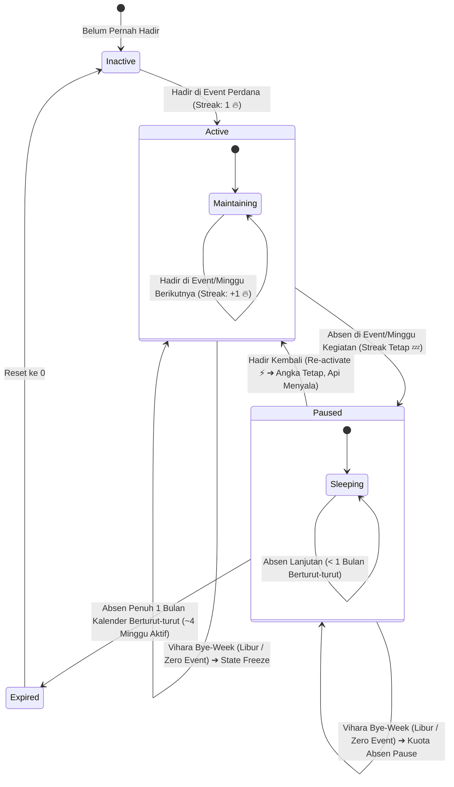
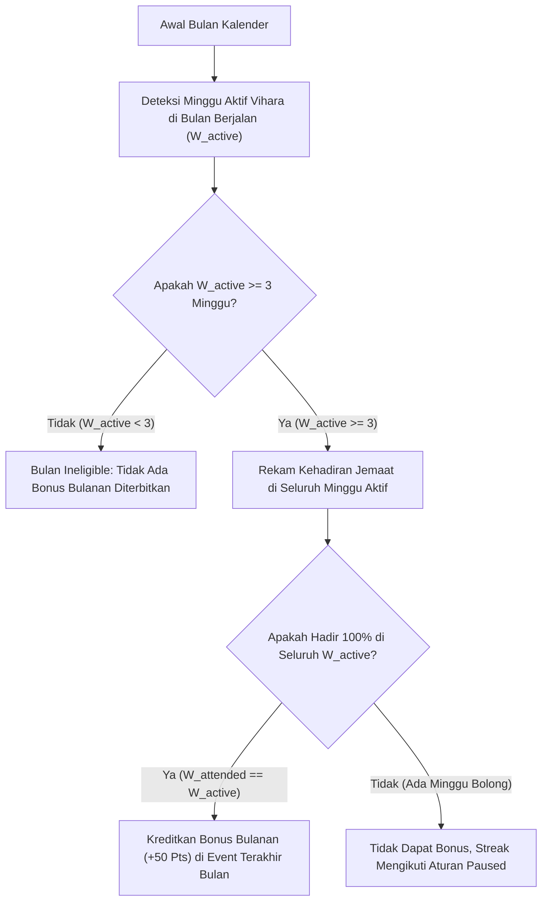

# PRD: Weekly Attendance Streak System — Sekkha Apps

| Metadata | Detail |
| --- | --- |
| **Dokumen** | Product Requirement Document (PRD) |
| **Fitur** | Sistem Keaktifan Komunitas (Event-Inclusive Streak & Perfect Month Gamification Engine) |
| **Domain** | `gamification` / `attendance` / `home` / `leaderboard` |
| **Aplikasi** | Sekkha Apps (Frontend & Backend) |
| **Versi** | 2.3.0 (TikTok-Style State Engine & Calendar-Aligned System) |
| **Status** | Approved / Synchronized with Product Direction |
| **Referensi Terkait** | `prd-sekkha/configure/pointRules.md`, `prd-sekkha/home/home.md`, `prd-sekkha/leaderboard/leaderboard.md`, `prd-sekkha/event/event.md`, `prd-sekkha/api-contract.md` |

---

## 1. Ringkasan Eksekutif & Filosofi Desain

Sistem **Streak Keaktifan Komunitas** di Sekkha Apps dirancang untuk membangun kebiasaan dan merawat ikatan persaudaraan pemuda Buddhis secara berkesinambungan di Vihara Tri Maha Dharma.

Mengadopsi pola psikologi gamifikasi modern ala *TikTok Streak* yang disesuaikan secara manusiawi dan bijak dengan ritme komunitas vihara:

### 🎯 Prinsip Utama Desain:
1. **Inklusif Terhadap Seluruh Event Resmi (Event-Inclusive)**:
   - Kehadiran jemaat tidak hanya dihargai pada kebaktian rutin hari Minggu.
   - Seluruh kegiatan resmi vihara (kebaktian pemuda, kelas meditasi, baksos, lokakarya/workshop, kelas Dhamma, atau pelatihan kepemudaan) yang dihadiri jemaat berkontribusi aktif menjaga dan memperpanjang rantai streak.
2. **Siklus 3-State: Tidak Langsung Hangus (TikTok-Style Grace & Pause)**:
   - Absen 1 atau 2 kali **TIDAK langsung mereset streak ke nol**.
   - Sistem membekukan status streak menjadi **Paused / Disabled (Tertidur 💤)** sementara angkanya tetap utuh tersimpan.
   - Saat jemaat datang kembali, kehadiran pertama berfungsi sebagai **Re-aktivasi (Bangkit Lagi 🔥)** tanpa penambahan angka; baru pada kehadiran di event/minggu berikutnya counter streak bertambah (**+1**).
3. **Batas Toleransi Manusiawi: 1 Bulan Berturut-turut (Humanistic Expiration)**:
   - Rantai streak baru benar-benar **hangus dan reset ke 0 HANYA JIKA jemaat absen penuh selama 1 bulan kalender berturut-turut** (~4 minggu kegiatan berturut-turut tanpa ada kehadiran sama sekali).
   - Memberikan ruang bernapas bagi jemaat yang berhalangan sementara karena musim ujian sekolah/kuliah, sakit, atau urusan keluarga luar kota.
4. **Vihara Bye-Week (Minggu Tanpa Kegiatan Bersifat Netral & Bebas Penalti)**:
   - Jika pada minggu tertentu vihara libur / tidak menyelenggarakan kegiatan apapun (misal Hari Raya Imlek, libur akhir tahun, atau renovasi dharmasala), minggu tersebut **dilewati (skip)** secara netral.
   - Tidak ada pengurangan streak, tidak memicu status *Paused*, dan tidak mengurangi kuota toleransi absen 1 bulan.
5. **Bonus Konsistensi Bulanan Riil (*Perfect Month Attendance*)**:
   - Sistem membaca jumlah minggu aktif di bulan kalender berjalan (4 atau 5 minggu).
   - Jemaat yang hadir penuh di setiap minggu aktif sepanjang bulan kalender tersebut dihadiahi **Bonus Poin Bulanan** di akhir bulan.

---

## 2. Hak Akses & Peran (Role Matrix)

| Aksi / Kemampuan | `member` | `activist` | `organizer` | `admin` |
| --- | :---: | :---: | :---: | :---: |
| Melihat status streak pribadi (`Active` 🔥 vs `Paused` 💤) di Kartu Anggota & Home | ✅ | ✅ | ✅ | ✅ |
| Presensi event apapun untuk mengaktifkan / memperpanjang streak | ✅ | ✅ | ✅ | ✅ |
| Melihat klasemen komunitas berdasarkan metrik `Streak` di Leaderboard | ✅ | ✅ | ✅ | ✅ |
| Menerima Bonus Poin Bulanan (*Perfect Month Attendance*) | ✅ | ✅ | ✅ | ✅ |
| Menutup & memfinalisasi event yang memicu pemutakhiran streak jemaat | ❌ | ❌ | ✅ | ✅ |
| Mengatur bobot poin bonus bulanan di `/configure/rules/points` | ❌ | ❌ | ❌ | ✅ |
| Memantau analitik sebaran streak aktif vs tertidur di `/pengurus/analytics` | ❌ | ❌ | ✅ | ✅ |

---

## 3. Logika State Machine & Siklus Hidup Streak

Sistem mengelola keaktifan jemaat melalui 3 state deterministik:

### 3.1 Penjelasan Detail Tiap State

| State | Indikator Visual UI | Perilaku Nilai Counter | Keterangan & Aturan |
|---|:---:|:---:|---|
| **Active** | 🔥 **Api Menyala** | Bertambah (**+1**) setiap hadir di event/minggu berikutnya secara berkesinambungan | Jemaat dalam status rajin dan konsisten hadir di kegiatan vihara. |
| **Paused (Disabled)** | 💤 **Abu-abu / Tertidur** | **TETAP UTUH** (Tidak berkurang & tidak reset) | Terjadi saat jemaat absen di suatu minggu/event yang memiliki kegiatan. Status api mati sementara, namun seluruh angka akumulasi streak tersimpan aman. |
| **Re-activating** | ⚡ **Bangkit / Menyala Kembali** | **TETAP SAMA** (Belum bertambah) | Jemaat hadir kembali untuk pertama kalinya saat status *Paused*. Presensi ini bertindak sebagai pemantik api: status berubah kembali menjadi **Active**, angka streak lama dipertahankan. |
| **Continuing Active** | 🔥 **Nambah Lagi** | Bertambah (**+1**) | Jemaat hadir kembali di event/minggu berikutnya setelah status kembali *Active*. |
| **Expired (Reset)** | ❌ **Reset ke 0** | Menjadi **`0`** | Terjadi **HANYA JIKA** jemaat tidak hadir sama sekali selama **1 bulan kalender penuh berturut-turut** (~4 minggu berturut-turut pada minggu-minggu yang menyelenggarakan kegiatan). |

---

## 4. Kasus Khusus: Minggu Tanpa Aktivitas (*Vihara Bye-Week*) & Vihara Tutup Penuh

### 4.1 Definisi Vihara Bye-Week
Minggu kalender ISO di mana vihara **tidak menyelenggarakan kegiatan/event resmi apapun** (misalnya saat libur Tahun Baru Imlek, masa hening Waisak/retreat khusus, renovasi dharmasala, jeda ujian nasional, atau penutupan vihara sebulan penuh).

### 4.2 Aturan Sistem terhadap Bye-Week:
1. **Bukan Absen Pengguna**:
   Ketidakhadiran jemaat di minggu tanpa kegiatan **tidak boleh dihitung sebagai absen**. Jemaat tidak mungkin hadir pada acara yang memang tidak ada.
2. **Pembekuan Status (State Freeze)**:
   - Jika sebelum libur status jemaat adalah **Active (🔥)**, status tetap **Active (🔥)** di minggu libur tersebut.
   - Jika sebelum libur status jemaat adalah **Paused (💤)**, status tetap **Paused (💤)** dan **minggu libur ini TIDAK mengurangi kuota toleransi absen 1 bulan**.
3. **Penyambungan Mulus (Seamless Resume)**:
   Saat kegiatan vihara dimulai kembali di minggu aktif berikutnya, rantai streak jemaat langsung bersambung dari kondisi sebelum libur tanpa penalti sedikit pun.
4. **Vihara Tutup Sebulan Penuh (Full-Month Inactive)**:
   Jika dalam satu bulan kalender penuh sama sekali tidak ada kegiatan (0 event):
   - Seluruh streak jemaat dibekukan (*frozen*). **TIDAK ADA STREAK YANG HANGUS KE 0** (karena toleransi 1 bulan dihitung dari ~4 minggu berkegiatan, bukan hari kalender mati).
   - Tidak ada Bonus Poin Bulanan yang diterbitkan untuk bulan tersebut.

---

## 5. Bonus Poin Bulanan (*Perfect Month Attendance*)

Menggantikan sistem rolling 4-minggu sebelumnya, bonus konsistensi dihitung berbasis **kalender bulan riil** dengan ambang batas kelayakan minimal:

### 5.1 Spesifikasi Aturan Bonus Bulanan:
1. **Ambang Batas Kelayakan Bulan (*Minimum 3 Active Weeks Threshold*)**:
   - Bonus Poin Bulanan **HANYA AKTIF** jika dalam bulan kalender tersebut vihara menyelenggarakan **minimal 3 minggu kegiatan ($W_{\text{active}} \ge 3$)**.
   - Jika dalam satu bulan hanya ada **1 atau 2 minggu kegiatan** (misalnya karena 3 minggu lainnya libur renovasi/libur panjang), maka **TIDAK ADA BONUS BULANAN YANG DIBERIKAN** pada bulan tersebut.
   - *Justifikasi*: Bonus bulanan mencerminkan dedikasi konsistensi sebulan penuh. Kehadiran di $\le 2$ minggu tidak memenuhi bobot komitmen sebulan.
2. **Syarat Kelulusan Jemaat ($100\%$ Full Attendance)**:
   - Jika bulan memenuhi syarat ($W_{\text{active}} \ge 3$), jemaat wajib hadir di **setiap minggu aktif** dalam bulan tersebut tanpa ada satu pun minggu kegiatan yang terlewat ($W_{\text{attended}} = W_{\text{active}}$).
   - *Contoh*: Bulan dengan 5 minggu kalender memiliki 1 minggu libur Imlek ($W_{\text{active}} = 4$). Jemaat yang hadir di ke-4 minggu kegiatan berhak atas bonus bulanan.
3. **Waktu Eksekusi**:
   Bonus diberikan secara otomatis pada saat penutupan (*closing*) event terakhir di bulan kalender bersangkutan.
4. **Kekebalan Plafon Harian (*Daily Point Cap Immunity*)**:
   Bonus konsistensi bulanan kebal terhadap batas maksimal 150 poin harian karena merupakan hasil akumulasi dedikasi sebulan penuh.
5. **Idempotensi Transaksi**:
   Setiap transaksi bonus memiliki `referenceId` unik deterministik:
   $$\text{referenceId} = \text{"monthly\_streak:"} + \text{userId} + \text{":YYYY-MM"}$$
   *Contoh*: `monthly_streak:usr_clx987abc:2026-11`

### 5.2 Matriks Keputusan Kalender Bulanan

| Jumlah Minggu Acara ($W_{\text{active}}$) | Kelayakan Bonus Bulan | Syarat Kelulusan Jemaat | Dampak Rantai Streak Jemaat |
|---|:---:|---|---|
| **4 atau 5 Minggu** (Bulan Penuh) | ✅ Eligible | Hadir di seluruh 4 atau 5 minggu acara ($100\%$) | Bertambah normal di setiap minggu acara. |
| **3 Minggu** (Sebagian Libur) | ✅ Eligible | Hadir di seluruh 3 minggu acara ($100\%$) | Minggu libur di-skip, streak bersambung normal. |
| **2 Minggu** (Banyak Libur) | ❌ Ineligible | **Tidak ada bonus bulanan** (kurang dari 3 minggu) | Streak tetap bersambung normal saat hadir. |
| **1 Minggu** (Bulan Singkat) | ❌ Ineligible | **Tidak ada bonus bulanan** (kurang dari 3 minggu) | Streak tetap bersambung (+1) saat hadir. |
| **0 Minggu** (Vihara Tutup Penuh) | ❌ Ineligible | **Tidak ada bonus bulanan** | **Freeze total**. Status aman, tidak ada penalti. |

---

## 6. Simulasi Perjalanan Jemaat (Real-World Scenarios)

### Skenario 1: Sakit & Ujian Sekolah (Toleransi Paused)
* **Minggu 1 (1 Feb)**: Hadir kebaktian $\rightarrow$ Streak: `10` (🔥 Active)
* **Minggu 2 (8 Feb)**: Absen sakit $\rightarrow$ Streak: `10` (💤 Paused) ➔ *Angka tidak hilang!*
* **Minggu 3 (15 Feb)**: Absen ujian $\rightarrow$ Streak: `10` (💤 Paused) ➔ *Masih dalam toleransi 1 bulan.*
* **Minggu 4 (22 Feb)**: Hadir kembali $\rightarrow$ Streak: `10` (⚡ Re-activated!) ➔ *Api menyala lagi, angka tetap 10.*
* **Minggu 5 (1 Mar)**: Hadir kembali $\rightarrow$ Streak: `11` (🔥 Active (+1)) ➔ *Streak resmi bertambah!*

### Skenario 2: Libur Imlek di Tengah Bulan (Vihara Bye-Week)
* **Minggu 1 (18 Jan)**: Hadir kebaktian $\rightarrow$ Streak: `4` (🔥 Active)
* **Minggu 2 (25 Jan)**: **Libur Imlek (Zero Event)** $\rightarrow$ *Bye-Week (Dilewati)* ➔ Status tetap `4` (🔥 Active)
* **Minggu 3 (1 Feb)**: Hadir kebaktian $\rightarrow$ Streak: `5` (🔥 Active (+1)) ➔ *Bersambung mulus!*
* *Hasil Bonus Bulanan*: Hadir di seluruh minggu aktif bulan Januari $\rightarrow$ Memperoleh Bonus Bulanan Januari.

### Skenario 3: Menghilang Lebih dari 1 Bulan Penuh (Streak Expired)
* **Minggu 1 (1 Jan)**: Hadir $\rightarrow$ Streak: `12` (🔥 Active)
* **Minggu 2 s/d Minggu 6 (8 Jan s/d 5 Feb)**: Absen berturut-turut selama >4 minggu aktif (melewati 1 bulan kalender penuh) tanpa ada kehadiran satu pun.
* **Minggu 7 (12 Feb)**: Datang kembali $\rightarrow$ Streak: `1` (🔥 Active Baru) ➔ *Streak lama hangus ke 0 karena absen >1 bulan, rekor `longest_streak: 12` tetap tersimpan di profil.*

---

## 7. Integrasi Antarmuka Pengguna (UI Touchpoints)

| Komponen UI | Lokasi | Representasi State Streak |
| --- | --- | --- |
| **Home Dashboard** | `HomePage.tsx` | - **Active**: Lencana oranye menyala `🔥 {streak}x Active` / `🔥 {streak}w Streak`. - **Paused**: Lencana abu-abu `💤 {streak}w Paused (Attend next to reactivate)`. |
| **Digital Member Card** | `DigitalMemberCard.tsx` | Chip status pada kartu QR: - Active: `🔥 {streak} Wk Streak` - Paused: `💤 {streak} Wk Paused` |
| **Profil Anggota** | `ProfilePage.tsx` | Menampilkan `Current Streak` (beserta badge status aktif/paused) dan `Longest Streak` (rekor tertinggi abadi). |
| **Leaderboard** | `LeaderboardPage.tsx` | - **Tab Metrik Dihapus**: Tab pilihan metrik `Streak` **dihapus** dari Leaderboard; Leaderboard murni menampilkan persaingan musiman `Points` dan `Attendance`. - **Primary Tie-Breaker**: Angka streak aktif jemaat dimanfaatkan di balik layar sebagai pemecah seri utama (*primary tie-breaker*) ketika dua anggota memiliki perolehan poin yang sama pada musim bersangkutan. |
| **Insight Pengurus** | `InsightPage.tsx` | Visualisasi pastoral: Rasio anggota `Active Streak` vs `Paused Streak` vs `At-Risk Expiring` (absen mendekati 1 bulan) untuk follow-up perhatian pengurus. |

---

## 8. User Stories & Acceptance Criteria

### US-STRK-01: Perpanjangan Streak saat Hadir Berkelanjutan
> **Sebagai seorang** anggota komunitas pemuda (`member`),  
> **Saya ingin** streak saya bertambah setiap kali saya hadir di kegiatan vihara secara kontinu,  
> **Agar saya** merasa dihargai atas dedikasi dan konsistensi saya.

* **AC-STRK-01.1**: Ketika jemaat berstatus `Active` hadir di event pada minggu/jadwal berikutnya, counter streak bertambah 1.
* **AC-STRK-01.2**: Kehadiran di event non-kebaktian (meditasi/baksos) yang diselenggarakan vihara diakui sah menambah keaktifan streak.

### US-STRK-02: Status Paused saat Berhalangan Hadir
> **Sebagai seorang** anggota komunitas yang sedang berhalangan hadir (sakit/ujian),  
> **Saya ingin** angka streak saya tidak langsung terhapus menjadi nol,  
> **Agar usaha** yang telah saya bangun selama berminggu-minggu sebelumnya tidak sia-sia.

* **AC-STRK-02.1**: Jika jemaat absen pada minggu yang memiliki kegiatan, status streak berubah menjadi `Paused`.
* **AC-STRK-02.2**: Nilai angka streak tidak mengalami pengurangan dan tidak di-reset ke 0.
* **AC-STRK-02.3**: Antarmuka menampilkan status `Paused` dengan pesan motivasi yang ramah untuk hadir kembali.

### US-STRK-03: Re-aktivasi Streak saat Hadir Kembali
> **Sebagai seorang** anggota komunitas berstatus `Paused`,  
> **Saya ingin** kehadiran perdana saya membangkitkan kembali api streak saya,  
> **Agar saya** termotivasi untuk kembali konsisten ke vihara.

* **AC-STRK-03.1**: Saat jemaat berstatus `Paused` menghadiri event (dalam batas toleransi <1 bulan), status berubah kembali menjadi `Active`.
* **AC-STRK-03.2**: Angka streak pada kehadiran re-aktivasi ini dipertahankan sama (belum bertambah).
* **AC-STRK-03.3**: Pada kehadiran berikutnya setelah aktif kembali, angka streak bertambah (+1).

### US-STRK-04: Reset Streak jika Absen 1 Bulan Berturut-turut
> **Sebagai seorang** pengurus vihara,  
> **Saya ingin** streak di-reset jika anggota tidak hadir sama sekali selama 1 bulan kalender berturut-turut,  
> **Agar metrik** streak tetap mencerminkan keaktifan nyata jemaat saat ini.

* **AC-STRK-04.1**: Jika jemaat tidak memiliki catatan kehadiran di seluruh minggu aktif selama 1 bulan kalender berturut-turut, status menjadi `Expired` dan streak di-reset ke 0.
* **AC-STRK-04.2**: Rekor `longest_streak` historis di profil anggota tidak terhapus.

### US-STRK-05: Perlindungan Minggu Libur (Vihara Bye-Week)
> **Sebagai seorang** anggota komunitas,  
> **Saya ingin** minggu-minggu di mana vihara libur tidak merugikan streak saya,  
> **Agar sistem** bersikap adil terhadap situasi operasional vihara.

* **AC-STRK-05.1**: Minggu kalender yang memiliki 0 event berstatus `closed` dilewati (*skipped*) dalam evaluasi absensi.
* **AC-STRK-05.2**: Minggu libur tidak mengubah state jemaat (tetap `Active` jika sebelumnya `Active`, tetap `Paused` jika sebelumnya `Paused`).
* **AC-STRK-05.3**: Minggu libur tidak memotong kuota batas toleransi absen 1 bulan.

### US-STRK-06: Perolehan Bonus Bulanan Penuh
> **Sebagai seorang** anggota yang hadir di seluruh minggu aktif dalam satu bulan kalender,  
> **Saya ingin** menerima Bonus Poin Bulanan,  
> **Agar komitmen** sebulan penuh saya diapresiasi secara istimewa.

* **AC-STRK-06.1**: Sistem memeriksa apakah seluruh minggu aktif dalam bulan kalender terpenuhi oleh jemaat.
* **AC-STRK-06.2**: Jika terpenuhi 100%, sistem mengkreditkan bonus poin bulanan pada penutupan event terakhir di bulan tersebut.
* **AC-STRK-06.3**: Transaksi bonus memiliki `referenceId` unik berformat `monthly_streak:{userId}:{YYYY-MM}`.

---

## 9. Matriks Uji Kasus & Skenario Tepi (Test Cases)

| ID Uji | Skenario | Input Data | Ekspektasi Hasil |
| --- | --- | --- | --- |
| **TC-STRK-01** | Pengguna baru hadir perdana | Presensi pertama kali | `status: "active"`, `current_streak: 1`, `longest_streak: 1` |
| **TC-STRK-02** | Hadir 3 minggu berturut-turut | Presensi di Minggu 1, Minggu 2, Minggu 3 | `status: "active"`, `current_streak: 3`, `longest_streak: 3` |
| **TC-STRK-03** | Absen 1 minggu (Sakit) | Hadir M1, M2, absen M3 | `status: "paused"`, `current_streak: 2` (Angka tetap utuh) |
| **TC-STRK-04** | Hadir kembali setelah absen 1 minggu | Hadir M1, M2, absen M3, hadir M4 | `status: "active"`, `current_streak: 2` (Re-activated, angka belum nambah) |
| **TC-STRK-05** | Melanjutkan kehadiran setelah re-aktivasi | Hadir M1, M2, absen M3, hadir M4, hadir M5 | `status: "active"`, `current_streak: 3` (Resmi bertambah +1) |
| **TC-STRK-06** | Absen penuh >1 bulan kalender | Hadir M1, absen penuh M2 s/d M6 (>1 bulan aktif) | `status: "expired"`, `current_streak: 0`, `longest_streak: 1` |
| **TC-STRK-07** | Vihara libur (Bye-Week) | Hadir M1, vihara libur Imlek di M2 (0 event), hadir M3 | `status: "active"`, `current_streak: 2` (Bye-week dilewati, streak nyambung) |
| **TC-STRK-08** | Bye-Week saat posisi Paused | Hadir M1, absen M2 (Paused), libur M3 (Bye-Week), hadir M4 | M3 tidak memotong kuota absen; M4 berhasil re-activate streak |
| **TC-STRK-09** | Bonus Bulanan Kalender Penuh | Hadir di seluruh minggu aktif bulan berjalan (mis. 4 dari 4 minggu) | Transaksi `monthly_streak:...` terkreditkan (+50 Pts) |
| **TC-STRK-10** | Verifikasi Idempotensi Bonus Bulanan | Penutupan event terakhir dipicu ulang 2x | Transaksi bonus bulanan hanya dibuat tepat 1 kali |
| **TC-STRK-11** | Bulan Kurang dari 3 Minggu Kegiatan | Bulan hanya ada 2 minggu acara ($W_{\text{active}} = 2 < 3$), hadir di kedua minggu | Streak bertambah normal, tetapi **TIDAK ADA BONUS BULANAN** (ineligible $<3$ minggu) |
| **TC-STRK-12** | Vihara Tutup Sebulan Penuh | 0 acara selama sebulan kalender ($W_{\text{active}} = 0$) | Streak seluruh jemaat di-freeze (tidak ada yang hangus), tidak ada bonus bulanan |

---

## 10. Non-Functional Requirements (NFR)

1. **Efisiensi Algoritma ($O(N)$ / $O(M)$)**:
   - Evaluasi streak dievaluasi terhadap himpunan minggu aktif vihara (`Set<string>`) dengan waktu eksekusi $< 5\text{ ms}$ per user.
2. **Integritas Transaksi & Idempotensi**:
   - Pemutakhiran status dan penambahan poin bonus dijalankan dalam database transaction (`prisma.$transaction`) saat event ditutup.
3. **Penyimpanan Cache & EventBus Revalidation**:
   - Cache ringkasan keaktifan disimpan pada Redis (`CacheKeys.dashboard(userId)`).
   - Invalidation terjadi secara otomatis saat penutupan event melalui Domain EventBus (`DomainEvents.EVENT_CLOSED`).
